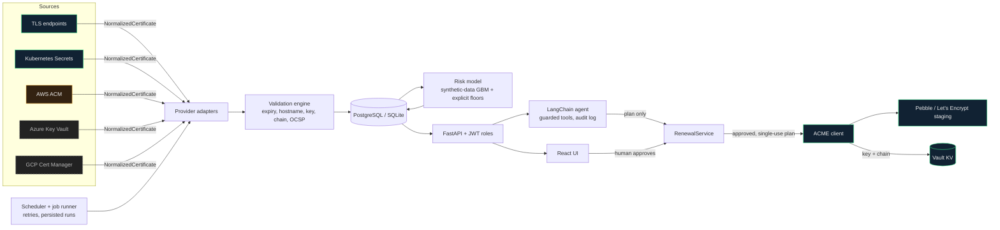

# CertOps AI: certificate lifecycle management

A platform that discovers TLS certificates across several sources, validates them, scores their risk, answers questions
about them through an LLM agent, and renews them through a **human-approved** ACME workflow.

> **Read the status table before the feature list.** Some integrations are real and tested against real systems, some
> are tested only against mocks or fixtures, and the risk model is trained on **synthetic** data. Nothing below claims
> more than the tests show.

## Status

| Area | Status | Evidence |
|---|---|---|
| TLS network discovery (presented chain, SNI) | **Real** | live local TLS servers (`tests/test_providers.py`, `tests/test_lab.py`) |
| Validation: expiry, hostname, key strength, weak signature, self-signed, trust path, OCSP revocation | **Real** | unit tests + 11 lab scenarios + a local OCSP responder |
| AWS ACM discovery | **Real code, tested against moto only** | never run against a real AWS account |
| Kubernetes `kubernetes.io/tls` Secrets | **Real**, run against a live cluster (Docker Desktop Kubernetes) | `tests/integration/test_k8s_cluster.py` |
| cert-manager `Certificate` status | **Simulated** | fixtures only |
| Azure Key Vault, GCP Certificate Manager | **Simulated** | fake clients shaped like the SDK responses; never run against Azure/GCP |
| Scheduled monitoring + retries + persisted runs | **Real** | retry/backoff and run state are unit-tested; the APScheduler wiring itself is not |
| Risk model (scikit-learn) | **Real model, trained and evaluated on SYNTHETIC data only** | [docs/risk_model.md](docs/risk_model.md) |
| LangChain agent | **Real graph, guardrails and audit; live Gemini NOT run** | scripted-model eval only; see "Agent evaluation" |
| ACME renewal + Vault secret storage | **Real**, run against a local Pebble CA and dev-mode Vault | `tests/integration/test_acme_pebble.py`; Let's Encrypt staging/production not exercised |
| AWS ACM renewal | **Not executable by design** (ACM cannot be force-renewed) | plans say so |
| Notifications (Slack, Teams, email, Jira) | **Code exists, never run against real services** | not covered by tests |
| Frontend | **Working**; unit/component tests plus a manual browser walkthrough | no automated end-to-end browser test |

## Architecture



Green = exercised against a real system, amber = mock only, dashed = fixtures only.

Key design points:

* **One normalized model.** Every provider returns the same `NormalizedCertificate`; validation, risk and the agent never see provider-specific shapes.
* **Tri-state results.** `chain_valid` and `revoked` are true / false / unknown. An unreachable or unverifiable OCSP response yields *unknown*, never "not revoked".
* **One renewal chokepoint.** `RenewalService` plans (dry run), approves (signed-in human only) and executes (approved, unexpired, unchanged, single-use plan). The agent can create plans but has no approve tool.

## Quick start

```bash
cp .env.example .env              # set SECRET_KEY, ADMIN_PASSWORD, POSTGRES_PASSWORD
docker compose up --build         # UI http://localhost:3000, API http://localhost:8000/docs
```

Sign in with `ADMIN_USERNAME` / `ADMIN_PASSWORD`. Self-registration is off (`ALLOW_REGISTRATION=false`) and, when on, creates read-only users.

Without Docker (Windows): `powershell -ExecutionPolicy Bypass -File scripts/dev.ps1`.

## Demo walkthrough (about 5 minutes, everything local)

1. **Start the labs.** Certificates with deliberate problems, and a real ACME CA plus Vault:
   ```bash
   cd backend && python -m app.devtools.lab &                              # 11 TLS endpoints + OCSP responder, registers scan targets
   docker compose -f ../docker-compose.renewal-lab.yml up -d             # Pebble, challenge mock, Vault (dev mode)
   ```
2. **Run the API trusting the lab** (see `.env.example` for each variable):
   `ALLOW_PRIVATE_TARGETS=true TRUST_STORE_EXTRA_PEM=../lab/certs/ca.pem ACME_DIRECTORY_URL=https://localhost:14000/dir ACME_VERIFY_TLS=false ACME_CHALLENGE=challtestsrv ACME_CHALLTESTSRV_URL=http://localhost:8055 VAULT_ADDR=http://localhost:8200 VAULT_TOKEN=dev-root-token LETSENCRYPT_EMAIL=ops@example.com uvicorn app.main:app`
3. **UI:** `cd frontend && npm ci && npm run dev`, sign in, **Sources → Run discovery**. The dashboard shows 11 certificates, one expired, one expiring in 3 days, three with invalid chains, one revoked.
4. **Renew one for real:** open `healthy.lab.test` → *Enable renewal provider* → *Plan renewal (dry run)* → review the steps → *Approve & execute*. A new certificate is issued by Pebble and its key and chain are stored in Vault (`secret/certops/healthy.lab.test`); the key never appears in the database, API responses or logs.
5. **Agent:** set `GEMINI_API_KEY` in `.env` (never in chat or code), then ask "Which prod certificates expire in 14 days?" or "Create a renewal plan for healthy.lab.test". The agent creates the plan; it appears under **Renewals** awaiting your approval.

| Lab endpoint (SNI) | Problem | Expected status |
|---|---|---|
| healthy.lab.test | none | valid |
| expiring.lab.test | expires in 3 days | expiring_soon |
| expired.lab.test | expired 10 days ago | expired |
| wrong-host.lab.test | certificate is for another name | hostname_mismatch |
| selfsigned.lab.test | self-signed | invalid_chain |
| nochain.lab.test | server omits the intermediate | invalid_chain |
| legacy.lab.test | RSA-1024 key | weak_crypto |
| rogue.lab.test | issued by an untrusted CA | invalid_chain |
| app.wild.lab.test | wildcard certificate | valid |
| ocsp-good / ocsp-revoked.lab.test | OCSP responder says good / revoked | valid / revoked |

## Results

Every number in this table is written by `scripts/collect_results.py` from its own run output (not typed by hand).

<!-- RESULTS:START -->
<!-- generated by scripts/collect_results.py at 2026-10-10T14:18:14+00:00 (commit c608505); do not edit by hand -->
| What | Result | How to reproduce |
|---|---|---|
| Backend tests (default suite, no external systems) | 188 passed, 0 failed, 7 skipped (the skipped ones are the integration tests) | `cd backend && pytest` |
| Backend integration tests (real Pebble ACME CA, Vault, PostgreSQL, Kubernetes) | 7 passed, 0 failed, 0 skipped | start the labs (see README), then `KUBE_INTEGRATION=1 RENEWAL_INTEGRATION=1 PG_TEST_URL=... pytest tests/integration` |
| Backend line coverage | 84.4% | `cd backend && pytest --cov=app` |
| Frontend tests | 100 passed, 0 failed | `cd frontend && npm test` |
| Frontend coverage | statements 99.22%, branches 87.26%, functions 92%, lines 99.22% | `cd frontend && npm run test:coverage` |
| Risk model, **synthetic data only** | ROC-AUC 0.863 vs 0.694 for the days-to-expiry rule; PR-AUC 0.568 vs 0.440; F1 0.505 vs 0.499 (precision 0.596, recall 0.438) | `cd backend && python -m app.ml.evaluate` |
| Risk model gap vs rule (95% bootstrap CI) | ROC-AUC +0.127 to +0.214 | same command |
| Agent eval, **scripted stand-in model** | 27/27 cases (100.0%). Tested workflow behavior (tools, guardrails, approval gate), **not model accuracy** | `cd backend && python -m app.agent.eval` |
| Agent eval, live Gemini | **not run** (no API key during development) | `python -m app.agent.eval --backend live --record c.json` |
<!-- RESULTS:END -->

### Risk model: synthetic data only

There is no labelled real-world incident data. The model is trained and scored on a documented simulator, so its metrics show how well it recovers *that simulator's* structure, **not** real-world accuracy. At the F1-optimal threshold it is essentially tied with a days-to-expiry rule; its advantage is in ranking, and most of that comes from features the simulator was wired to reward. Full details, assumptions and limitations: [docs/risk_model.md](docs/risk_model.md).

### Agent evaluation: scripted and live are separate

The scripted number is evidence of **tested workflow behavior** (tool layer, human-approval gate, role restrictions, allow-list, audit), **not real-model accuracy**: a keyword stand-in chose the tools. **No live Gemini evaluation has been run.** A live result will get its own row and will never be merged with the scripted one. The eval harness itself is tested: breaking the approval gate, role checks or search results makes it fail. Details: [docs/agent.md](docs/agent.md).

## Security model

* **Auth:** JWT, roles `viewer` / `operator` / `admin`; every write endpoint enforces its role on the server (the UI only mirrors this).
* **SSRF guard:** scan targets and OCSP URLs to loopback/private/link-local addresses are refused unless `ALLOW_PRIVATE_TARGETS=true`; connections go to the vetted IP, OCSP follows no redirects and refuses `https`.
* **Renewal:** dry run, then human approval, then single-use execution. Plans expire after 15 minutes, are bound to the certificate state, and each actor may hold at most 20 plans awaiting approval. The production ACME directory is blocked unless explicitly enabled.
* **Secrets:** nothing in code; `.env` is gitignored; issued private keys go to Vault only; the app refuses to start in production with a missing or placeholder `SECRET_KEY`.
* **Agent:** tool allow-list, role-based tool sets, call budget, timeouts, output sanitising, and an audit row for every attempt (including denied and malformed calls). Certificate fields are treated as untrusted data.

## Project layout

```
backend/app/
  providers/    network, AWS ACM, Kubernetes, Azure, GCP adapters + registry
  validation/   engine (checks), trust store, hostname matching, OCSP
  renewal/      RenewalService, ACME executor, Vault secret store, AWS (non-executable)
  agent/        tools + guardrail runner, LangChain agent, RCA knowledge, eval harness and stand-in models
  ml/           features, synthetic simulator, training, evaluation, serving
  routers/      FastAPI endpoints          jobs.py / scheduler.py   job runner and schedule
  devtools/     test PKI, local certificate lab, OCSP responder
  services/     pipeline (persist + status + risk), ownership discovery, notifications
backend/alembic/   migrations (0001-0003)         backend/tests/   unit, API, lab and integration tests
frontend/src/      pages, components, lib/format.js (pure helpers), __tests__/
docs/              risk_model.md, agent.md, results/ (generated), RESUME_CLAIMS.md
scripts/           dev.ps1, collect_results.py
```

## Testing and CI

```bash
cd backend && pip install -r requirements-dev.txt -c constraints.txt
ruff check . && pytest --cov=app                  # default suite: no external systems
cd ../frontend && npm ci && npm run test:coverage && npm run build
```

Integration tests (skipped unless enabled): Kubernetes (`KUBE_INTEGRATION=1`, needs a cluster), ACME + Vault (`RENEWAL_INTEGRATION=1`, needs `docker-compose.renewal-lab.yml`), PostgreSQL race (`PG_TEST_URL=...`). GitHub Actions (`.github/workflows/ci.yml`) runs lint, tests with an 80% coverage floor, a dependency audit, migrations on PostgreSQL, the Pebble/Vault integration test, the frontend tests and build, and the Docker builds. **The workflow has not run on GitHub yet**; its commands were run locally and in clean Linux containers.

## Limitations

* **Risk model is synthetic.** No real-world accuracy claim is made. Retraining on real history means feeding `app/ml/features.py` real renewal and incident data.
* **No live LLM result.** The agent's tool selection and answers have not been measured with Gemini. Free-tier rate limits will slow a live eval.
* **Integrations by evidence:** Azure, GCP and cert-manager are fixtures only; AWS ACM is moto only; Let's Encrypt staging/production were not exercised (Pebble was).
* **Renewal stops at issuance.** The new certificate and key are stored in Vault; deploying them to the endpoint is not automated. Wildcards (DNS-01) are unsupported. ACM cannot be force-renewed.
* **Revocation is OCSP-only.** CRLs are not checked, and some CAs have retired OCSP, so "revocation unknown" will be common.
* **Ownership discovery** works from Kubernetes annotations; the Git `CODEOWNERS` and catalog paths exist but no caller supplies a repository.
* **Notifications** (Slack, Teams, email, Jira) have never been run against real services.
* **Scale:** the dashboard's "needs attention" list reads the first 200 certificates; there is no server-side sorting; the scheduler is in-process (run one API worker).
* **Untested extras:** the example manifests in `k8s/` (placeholder image names, never applied) and `docker-compose.lab.yml`'s use outside the documented walkthrough; there is no frontend linter (ruff covers the backend only).
* **Not tested:** the APScheduler schedule itself, light theme and mobile layout, any automated end-to-end browser flow.
* **Pinned and audited today, not forever:** `pip-audit` was clean when last run; new advisories will appear.
